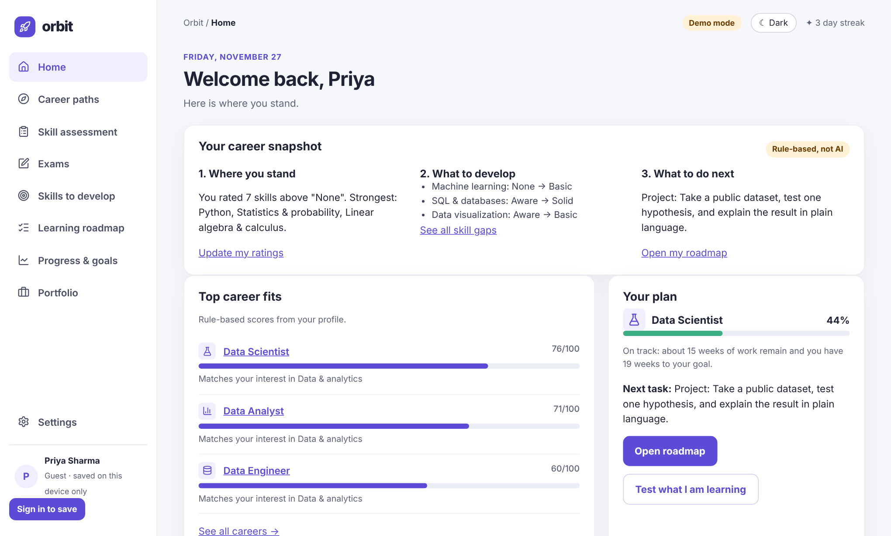
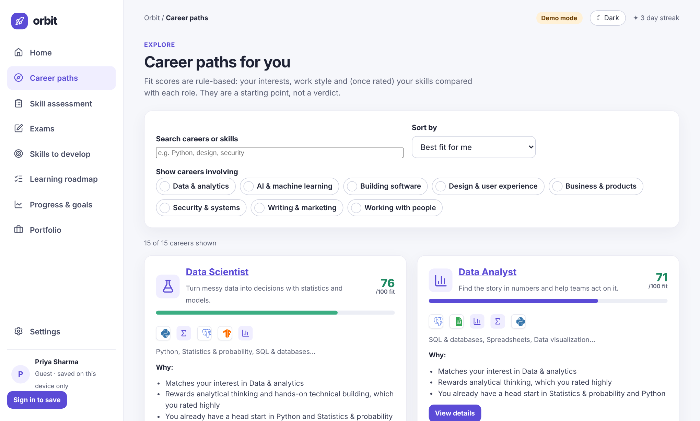

# Orbit: career guidance for students

Orbit helps a student answer three questions: where do I stand, what should I learn, and what should I do next. It suggests careers that match the student's interests, checks their skills, shows the gaps for the chosen career, and builds a step-by-step plan with projects. The student then tracks progress and can change their goal at any time.

It works fully without an API key. With a key, an AI coach (Claude) writes extra advice. Every screen says whether the text came from the AI or from built-in rules.

## Demo video

<!--
  VIDEO PLACEHOLDER. Replace the line below when the final video is ready.

  Option 1, YouTube or other link:
  [](https://your-video-link)

  Option 2, file in this repo (keep it under 100 MB):
  1. Copy the file to docs/orbit-demo.mp4
  2. Use this line:
  <video src="docs/orbit-demo.mp4" controls width="100%"></video>
-->

Demo video: to be added.

## The problem

Students often pick a career from guesswork. Orbit replaces that with a clear picture: how well the student fits a role, which skills are missing, and a plan to close the gaps.

## Key features

| Step | What the student gets |
|---|---|
| Explore | 15 careers ranked by fit, with the reasons for each match and a score breakdown |
| Assess | Ratings for 31 skills, short quick checks for 10 of them, and personalised exams with 120 built-in questions |
| Find gaps | The skills the chosen career needs, ordered from biggest gap to smallest, with estimated hours per skill |
| Plan | A roadmap in four phases (foundations, core skills, advanced, capstone), with tasks, projects and free learning links, sized to the student's weekly hours |
| Track | A readiness score, a six-month activity heatmap, streaks, exam scores and achievements, in a style similar to coding-practice sites |
| Show | A portfolio built from finished project tasks. It can be copied as Markdown or printed as a one-page view |
| Save | Accounts with email and password, or continue as a guest. Progress syncs across devices |

The Home page shows a short snapshot: where you stand, what to develop, and what to do next.

## What makes Orbit stand out

- **Explainable fit scores.** Each career shows its match as three weighted parts: interests (45%), work style (25%) and skills (30%). The reasons are written in plain words, so a student can see exactly what drove the result.
- **Clear labels for AI and rules.** Every coaching panel and the header badge say "AI-generated by Claude" or "Demo mode: rule-based text, not AI". Students always know where advice comes from.
- **Works for everyone.** Every page is open to guests with no key and no account. AI is an optional extra, not a requirement.
- **Exams built from the student's own goal.** An exam can cover the roadmap milestone the student is on, their skill gaps, or the whole career. Each answer comes with an explanation, and a suggested rating change that the student accepts or ignores.
- **A readiness score that never guesses.** It combines skills (50%), roadmap progress (30%) and exam results (20%). Parts not measured yet are left out of the calculation rather than estimated.
- **Roadmap that respects progress.** Every task has a stable ID. Changing the career or the weekly hours never deletes finished work.
- **Sync without overwrites.** Each account has a revision number. Two devices merge their changes, so nothing is silently lost.
- **Portfolio links are safe.** Only `https://` links are accepted, and the server drops anything else.
- **Fast by design.** No framework, no web fonts and no build step. Each action has its own page, with small scripts, gzip and cached assets.
- **Accessible.** Every page passes an automated WCAG 2.0/2.1 A and AA scan in light and dark mode, and works at a 390 px phone width.

## Screenshots

| | |
|---|---|
|  |  |
|  |  |
|  |  |

A light theme is the default. A button in the top bar switches to dark mode.

## What is AI and what is rule-based

| Part | Source |
|---|---|
| Career fit score and the reasons shown | Rule-based |
| Skill gaps, roadmap, hour estimates, readiness score | Rule-based |
| Careers, skills, resources, project ideas, exam questions | Written by hand |
| Coach text on the Careers and Progress pages, optional AI-written exam questions | Claude, when an API key is set and the user is signed in |

## How AI is protected

- The key stays on the server and is never sent to the browser.
- Signed-in users only. Limits apply per user, per minute, per day and per server.
- Only a short summary is sent, and the student's name is never included.
- A failed AI call is refunded and the app falls back to rule-based text.

## Run it

You need Node.js 22.13 or newer.

```bash
npm install
npm start
```

Open http://localhost:3000. Everything works with no key.

To turn on the AI coach, set your key before starting:

```bash
export ANTHROPIC_API_KEY=your-key
npm start
```

Email accounts need a mail server (`SMTP_URL`, see `.env.example`). On localhost, confirmation and reset links are printed in the server console.

## How it is built

- Plain HTML, CSS and JavaScript on the front end. Each action has its own page.
- A small Node.js server with a SQLite database for accounts and saved progress.
- Guests keep their progress in their own browser. Signed-in users get it saved on the server.

## Security

- Passwords are hashed with scrypt. Emails, names and progress are encrypted with AES-256-GCM, and each value is bound to its row.
- Strict browser security headers, no inline scripts, and everything the student types is escaped.
- Sign-in is protected by account lockout, rate limits, single-use email links and a limit on emails sent.
- Secrets are read from environment variables only. A test checks that no key appears in any page or response.
- Two security reviews were completed, and every finding was fixed and tested.

## Testing

```bash
npm test            # logic, security, accounts and AI-proxy tests
npm run test:e2e    # real browser test of every page, plus an accessibility scan
```

GitHub Actions runs both on every push, with the browser test in Chromium, Firefox and WebKit.

## More

- Pitch deck: [docs/Orbit-pitch-deck-v2.pptx](docs/Orbit-pitch-deck-v2.pptx)
- Privacy details inside the app: `privacy.html`
