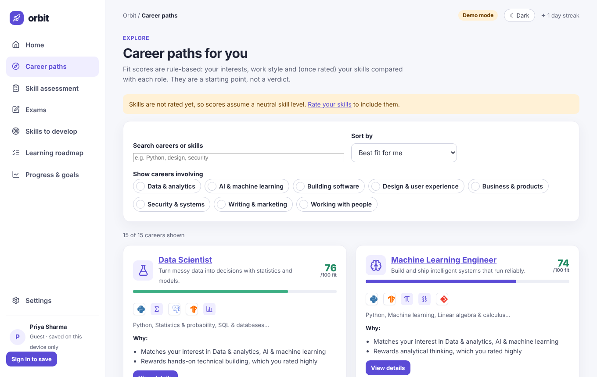
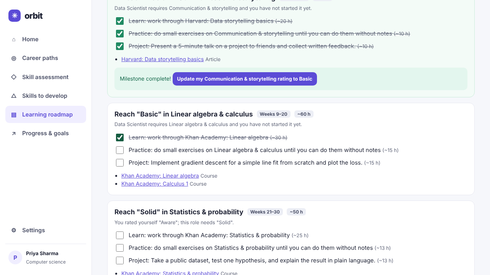
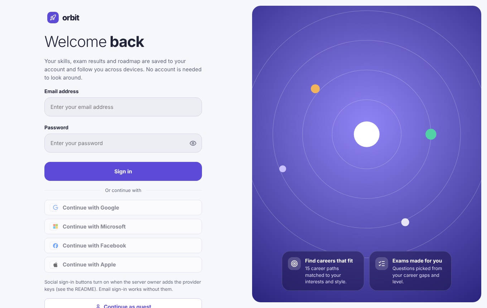
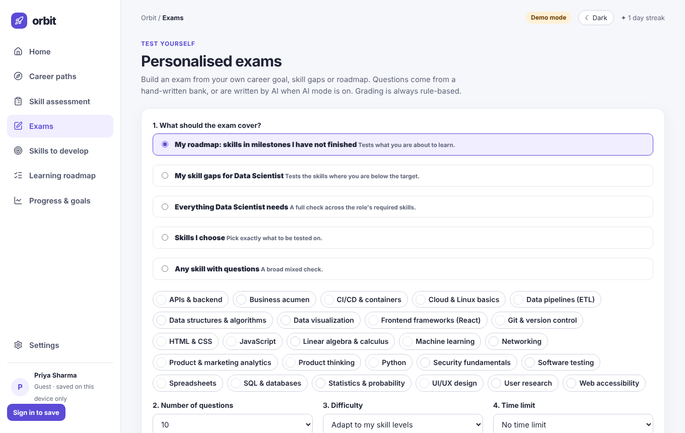
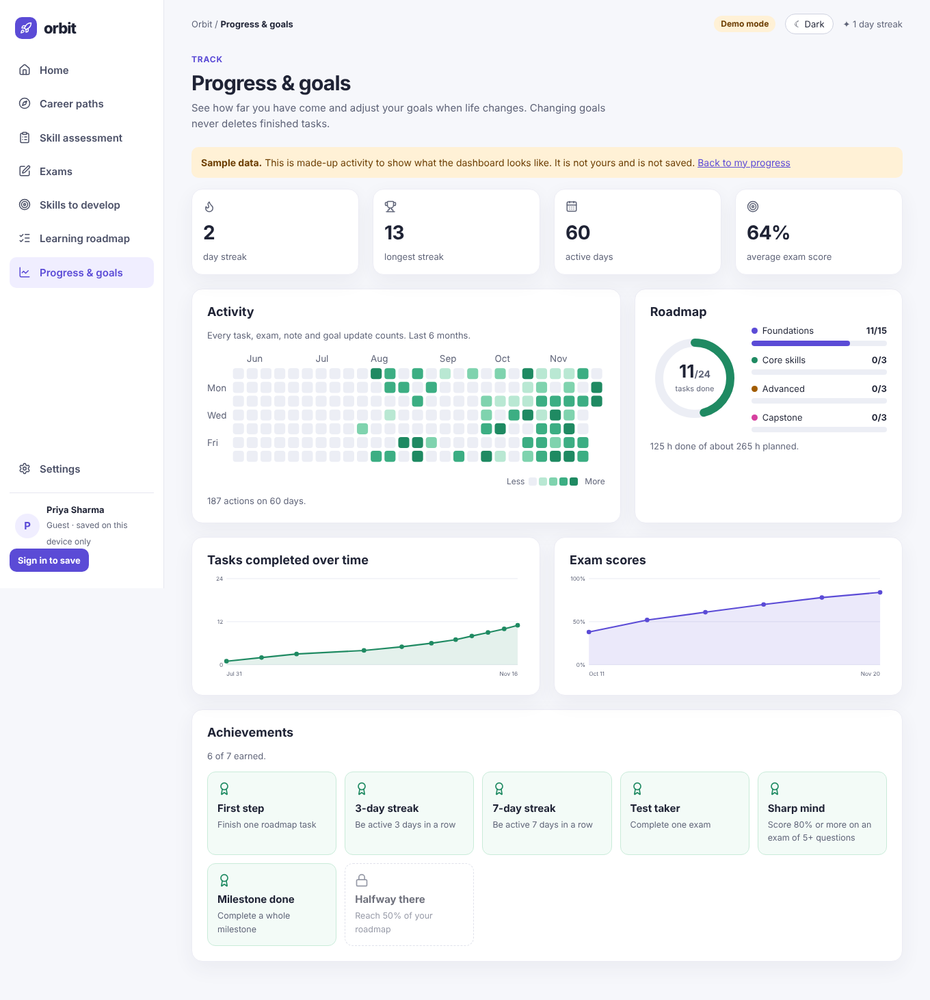
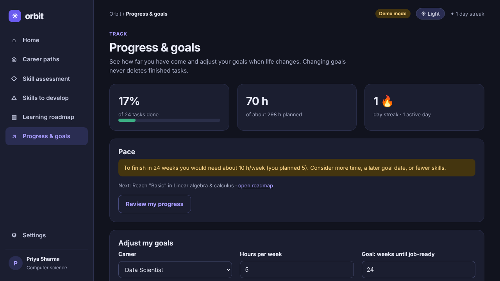

# Orbit: AI-assisted career development for students

Orbit helps a student explore careers, rate their skills, see what to learn for a chosen role, follow a step-by-step roadmap with projects and milestones, and track progress while adjusting goals.

It works fully **without an API key** (demo mode). If you add a key, an optional AI coach explains your matches and reviews your progress.

## Quick start

Requires Node.js 18+.

```bash
npm install          # only needed for AI mode; demo mode has no dependencies
npm start            # http://localhost:3000
```

Optional AI mode (key stays on the server, never in browser code):

```bash
export ANTHROPIC_API_KEY=your-key
export ANTHROPIC_MODEL=claude-opus-5-5   # optional, this is the default
npm start
```

Other settings: `PORT` (default 3000). Copy `.env.example` for reference; the server reads real environment variables, not a `.env` file.

Run the logic, security and sign-in tests with `npm test`. With the server running, `python3 tools/e2e.py http://localhost:3000` runs a real-browser check of every page and the account flow (needs `pip install playwright`).

## Screenshots and demo

| | |
|---|---|
|  |  |
|  |  |
|  |  |
|  |  |
|  | |

- Video walkthrough: [docs/orbit-demo.webm](docs/orbit-demo.webm)
- Pitch deck: [docs/Orbit-pitch-deck.pptx](docs/Orbit-pitch-deck.pptx)

The interface is light by default. A toggle in the top bar switches to dark mode and remembers the choice on that device.

## Pages (every action has its own URL)

| Page | What it does |
|---|---|
| `index.html` | Welcome for new users, dashboard afterwards |
| `onboarding.html` | Name, studies, interests, work-style sliders, weekly hours, goal weeks |
| `careers.html` | 15 careers ranked by fit, each with reasons |
| `career.html?id=…` | Role detail, required skills, choose this career |
| `login.html` | Sign in with Google, Microsoft, Facebook, Apple or email, or continue as a guest |
| `exam.html` | Personalised exam: pick scope (roadmap, gaps, whole career, chosen skills), size, difficulty, timer, bank or AI questions |
| `assessment.html` | Self-rate 31 skills, with optional 3-question quick checks for 10 of them (0 to 4) |
| `gaps.html` | Skills to develop for the chosen career, biggest gaps first |
| `roadmap.html` | Milestones in phases, tasks, projects, resource links, capstone |
| `progress.html` | LeetCode-style dashboard: activity heatmap, streaks, roadmap ring, tasks over time, exam scores, achievements; adjust career/hours/goal, notes. Add `?sample=1` to preview with made-up data |
| `settings.html` | Edit profile, download data, erase data |

Every page opens for guests with its own content. Only the Home page shows the welcome; other pages show empty states or neutral defaults until you set a profile.

## Sign-in and saved data

Guests keep progress in this browser only. Signed-in users get progress saved on the server and synced across devices (newest save wins).

| Method | Status |
|---|---|
| Email + password | Works with no setup. Passwords are hashed with scrypt; sessions use HttpOnly cookies. |
| Google, Microsoft, Facebook, Apple | Standard OAuth 2.0 authorization-code flow. **Each button turns on only when you add that provider's keys.** Buttons for providers without keys are greyed out. |

The OAuth code is tested against a local mock identity provider (`test/auth.test.mjs`: state check, code exchange, account creation, bad-state rejection). **It has not been run against the real Google, Microsoft, Facebook or Apple servers**, because that needs your own registered apps and a public HTTPS URL. Test each provider yourself after setting it up.

Set these environment variables, and register `BASE_URL/auth/<provider>/callback` as the redirect URL in each provider's console:

```
BASE_URL=https://your-domain            # defaults to http://localhost:PORT
GOOGLE_CLIENT_ID= GOOGLE_CLIENT_SECRET=
MICROSOFT_CLIENT_ID= MICROSOFT_CLIENT_SECRET=   # MICROSOFT_TENANT optional, default "common"
FACEBOOK_APP_ID= FACEBOOK_APP_SECRET=
APPLE_CLIENT_ID= APPLE_TEAM_ID= APPLE_KEY_ID= APPLE_PRIVATE_KEY=   # Apple needs a paid developer account
```

Accounts live in `data/orbit.json` (git-ignored). This file store suits a demo or one small server; use a real database for production.

## Personalised exams

`exam.html` builds a test from your own state: skills in unfinished roadmap milestones, your gaps, everything your career needs, or skills you pick. Questions come from a hand-written bank (`public/js/bank.js`), weighted toward your level; difficulty can adapt. With an API key you can choose **AI-written questions**, which are labelled as such and may contain mistakes. Grading is always done by Orbit. After an exam it can suggest changing a skill rating; you decide.

## Reference: React sign-in component

`reference/react-sign-in/` holds the shadcn/Tailwind/TypeScript `SignInPage` component you supplied, plus setup notes. **This app is plain HTML/JS, so that component is not used at runtime.** `login.html` re-creates its look (split layout, glass inputs, password toggle) in plain CSS. The testimonial cards were replaced by feature cards, because the demo testimonials were invented people.

## What is AI and what is not

| Feature | Source |
|---|---|
| Career fit scores and the "why" bullets | **Rule-based** (`public/js/engine.js`): 45% interests, 25% work style, 30% skills |
| Skill gaps, roadmap, hours, week estimates, progress, pace | **Rule-based** |
| Careers, skills, requirements, resources, project ideas | **Hand-written sample data** (`public/js/data.js`) |
| Coaching panel on Careers and Progress pages | **AI (Claude)** when a key is set, otherwise **rule-based templates** |

Every coaching panel and the header badge say which of the two you are seeing ("AI-generated by Claude" vs "Demo mode: rule-based text, not AI"). If an AI call fails, the app falls back to demo text and says so.

## How AI is wired

- The browser calls `POST /api/coach` on this server. The server holds the key and calls the official `@anthropic-ai/sdk`.
- Requests are validated and size-capped (60 KB), rate-limited per IP (12/min), and only a trimmed summary is sent. The student's name is **not** sent.
- Output uses a JSON schema (`output_config.format`) and is clipped before being returned.
- `GET /api/status` tells the page whether AI is on.

## Project layout

```
server.js            static server + /api/status, /api/coach, /api/exam (no framework)
lib/auth.js          OAuth, email sign-in, sessions, /api/data sync
lib/store.js         JSON file store
public/*.html        one page per action
public/js/data.js    sample careers, skills, resources
public/js/engine.js  scoring, gaps, roadmap, progress, demo coaching (pure functions)
public/js/app.js     shared shell, storage, AI/demo coaching client
public/js/<page>.js  one small script per page
test/engine.test.mjs logic tests
```

Performance: no framework, no web fonts, no build step, gzip and ETag caching on the server, small deferred scripts per page.

## Security

- API key is read from the environment only; no key or secret is ever written into a page, script or response (checked by `test/security.test.mjs`).
- Strict Content-Security-Policy (`script-src 'self'`, no inline scripts, no external resources), `X-Frame-Options: DENY`, `nosniff`, no-referrer, and a restrictive Permissions-Policy.
- Only the `public/` folder is served; traversal attempts, source files and dotfiles return errors.
- Sign-in: scrypt password hashes, HttpOnly + SameSite cookies, signed OAuth `state`, per-IP limits on attempts, custom-header check on state-changing calls.
- `/api/coach`: POST only, 60 KB body cap, per-IP rate limit, input trimmed, output clipped; model output is HTML-escaped in the browser.
- Everything the student types is escaped before display.

## Verified

`npm test` runs the scoring/roadmap logic tests and the security tests. In addition, the app was checked in a real browser (Chromium) in both modes: onboarding validation, redirect when no profile, ranking, career detail, assessment, gaps, roadmap ticking and persistence across reload, milestone completion, goal changes keeping finished tasks, notes, export, erase, escaping of user text, and no horizontal overflow at 390 px width. The AI path was tested against a local mock of the API (request shape, fallback on error, no key in browser code). **It has not been run against the live Anthropic API in this repo's test run**, so check it with your own key.

## Limitations

- Guests: data lives in the browser's local storage; clearing it erases progress. Signed-in users: saved in a JSON file on the server (no password reset email, no email verification, no "keep me signed in" option).
- Social sign-in is implemented and mock-tested only, see above.
- Skill levels are self-reported; fit scores are a rough guide, not a validated assessment.
- Hour estimates are rough averages. Resource links were opened and checked on 2026-11-24 but may change or move; they are not endorsements.
- Only 15 careers and 31 skills are included. No salary or job-market data is shown, on purpose.
- The AI coach cannot browse the web and sees only the summary the app sends.
- Accessibility basics are covered (labels, keyboard focus, skip link, contrast, reduced motion) but there was no screen-reader audit.
- Static hosting (for example GitHub Pages) works in demo mode; AI mode needs the Node server.

## Hackathon submission

Publish this repository on GitHub and submit its public URL through the Unstop competition portal before the deadline.
