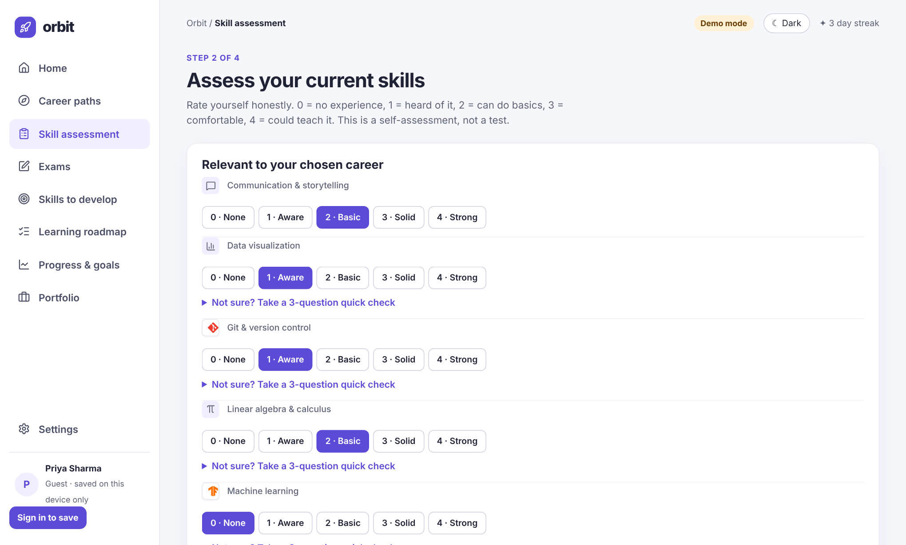
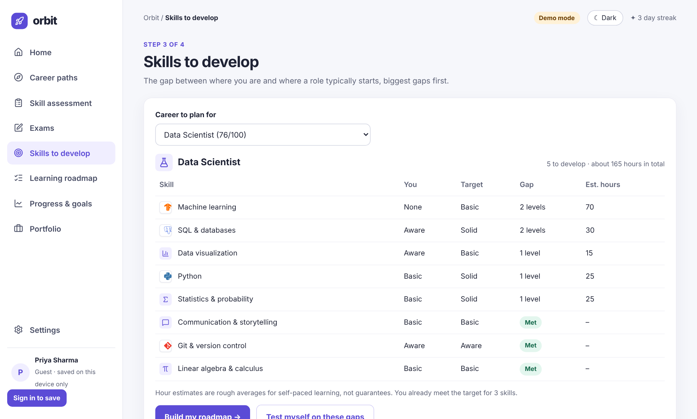
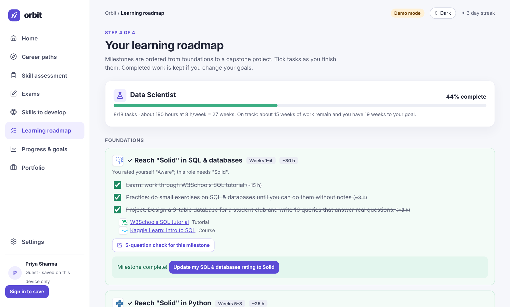
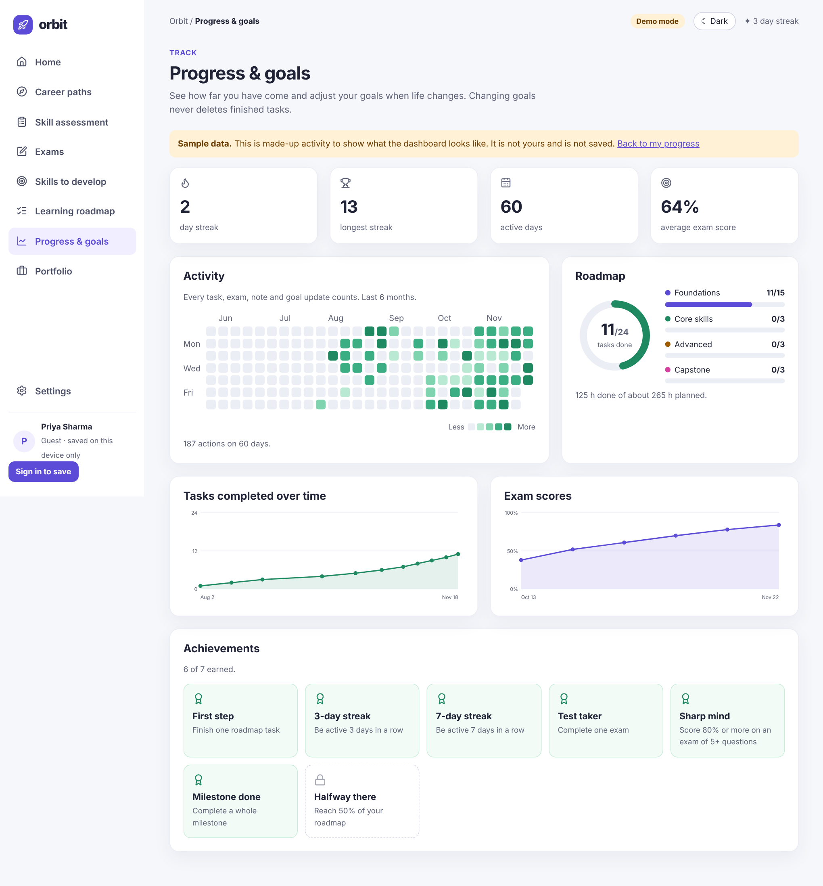

# Orbit: career guidance for students

Orbit helps a student answer three questions: where do I stand, what should I learn, and what should I do next. It suggests careers that match the student's interests, checks their skills, shows the gaps for the chosen career, and builds a step-by-step plan with projects. The student then tracks progress and can change their goal at any time.

It works without an API key. With a key, an AI coach (Claude) writes extra advice. Every screen says whether the text came from the AI or from built-in rules.

## Demo video

<!--
  VIDEO PLACEHOLDER. Replace the line below when the final video is ready.

  Option 1, YouTube or other link:
  [](https://your-video-link)

  Option 2, file in this repo (keep it under 100 MB):
  1. Copy the file to docs/orbit-demo.mp4
  2. Use this line:
  <video src="docs/orbit-demo.mp4" controls width="100%"></video>
-->

Demo video: to be added.

## The problem

Students often pick a career from guesswork. They do not know which skills a role needs, how far they are from it, or what to study first. Career websites list jobs but do not give a plan.

## What Orbit does

| Step | What the student gets |
|---|---|
| Explore | 15 careers ranked by fit with the student's interests and work style, with the reasons for each match |
| Assess | Self-rating of 31 skills, plus short quick checks and personalised exams (120 built-in questions) |
| Find gaps | A list of the skills the chosen career needs, biggest gap first |
| Plan | A roadmap in phases with tasks, projects, free learning links and a final project, sized to the student's weekly hours |
| Track | A readiness score, activity heatmap, streaks, exam scores and achievements. The goal, hours and career can be changed |
| Show | A portfolio page of finished projects that can be copied as Markdown or printed |

The Home page also shows a short snapshot: where you stand, what to develop, and what to do next.

## What is AI and what is not

| Part | Source |
|---|---|
| Career fit score and the reasons shown | Rule-based (interests 45%, work style 25%, skills 30%) |
| Skill gaps, roadmap, hour estimates, readiness score | Rule-based |
| Careers, skills, resources, project ideas, exam questions | Written by hand (sample data) |
| Coach text on the Careers and Progress pages, optional AI-written exam questions | Claude, only when an API key is set and the user is signed in |

Without a key, the coach text comes from fixed templates and is marked "Demo mode". If an AI call fails, the app falls back to the templates and says so.

## Screenshots

| | |
|---|---|
|  |  |
|  |  |
|  |  |

A light theme is the default. A button in the top bar switches to dark mode.

## Run it

You need Node.js 22.13 or newer.

```bash
npm install
npm start
```

Open http://localhost:3000. Everything works in demo mode, with no key.

To turn on the AI coach, set your key before starting. The key stays on the server and is never sent to the browser.

```bash
export ANTHROPIC_API_KEY=your-key
npm start
```

Sign-in with Google, Microsoft, Facebook or Apple, and real email, need extra settings. They are listed in `.env.example`. On localhost, confirmation and reset links are printed in the server console.

## How it is built

- Plain HTML, CSS and JavaScript on the front end. No framework and no build step. Each action has its own page.
- A small Node.js server with a SQLite database for accounts and saved progress.
- AI calls go through the server only. Signed-in users only, with per-user and per-day limits.
- Guests can use every page. Their data stays in their own browser.

## Security

- Passwords are hashed with scrypt. Emails, names and progress are encrypted in the database.
- Strict browser security headers, no inline scripts, and everything the student types is escaped.
- Sign-in is protected by account lockout, rate limits, and a limit on emails sent.
- Secrets are read from environment variables only. A test checks that no key appears in any page or response.

## Testing

```bash
npm test            # logic, security, accounts and AI-proxy tests
npm run test:e2e    # real browser test of every page, plus an accessibility scan
```

GitHub Actions runs both on every push, with the browser test in Chromium, Firefox and WebKit.

## Limitations

- Google, Microsoft, Facebook and Apple sign-in, real email delivery, and the live Claude call were tested only against mock servers. They need your own keys and an https address to test for real.
- No person has tested the app with a screen reader. The automated accessibility scan found no A or AA problems.
- Skill levels are self-rated, and the fit scores are a guide, not a validated test.
- Only 15 careers and 31 skills are included, and there is no salary or job-market data.
- The server runs as one process and uses Node's SQLite module, which Node still marks experimental.
- The AI coach cannot browse the web. It sees only the summary the app sends.

## More

- Pitch deck: [docs/Orbit-pitch-deck-v2.pptx](docs/Orbit-pitch-deck-v2.pptx)
- Privacy details inside the app: `privacy.html`
